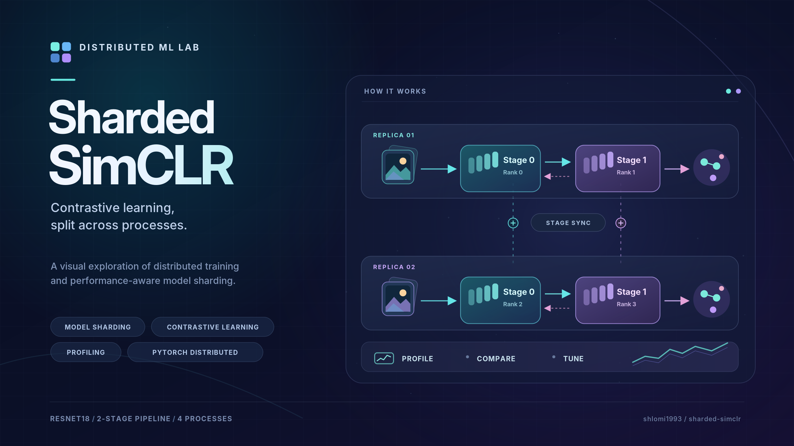
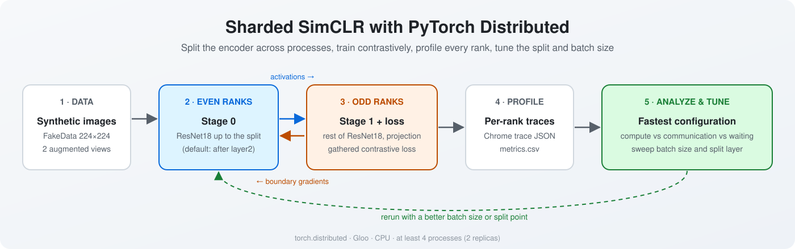
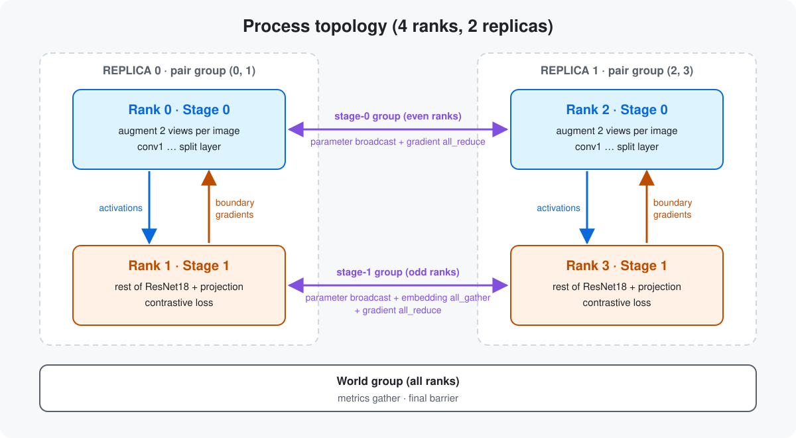

# Sharded SimCLR with PyTorch Distributed

[](https://github.com/shlomi1993/sharded-simclr/actions/workflows/ci.yml)
[](https://www.python.org/)
[](https://pytorch.org/)



A distributed training and profiling project that splits ResNet18 contrastive training across paired processes and tunes the batch size and split point using per-rank traces. The training protocol is written directly with `torch.distributed` point-to-point transfers and collectives.

The project demonstrates:

- **Model sharding** - ResNet18 split into two stages on separate processes
- **Manual gradient propagation** - activations and gradients passed across process boundaries by hand
- **Stage-wise data parallelism** - each stage replicated, with gradients averaged per stage
- **Distributed contrastive loss** - embeddings gathered from all replicas
- **Performance diagnosis** - backed by saved per-rank traces

It is a systems experiment that runs on CPU with the Gloo backend and deterministic synthetic images, so it doesn't evaluate representation quality or GPU scaling.



## How it works



Each even/odd pair of ranks forms one model replica. The even rank creates two augmented views per image and runs encoder stage 0. It then sends the activations to its odd partner. The odd rank runs stage 1 and the projection head, gathers embeddings from the other replicas, computes the contrastive loss, and sends the boundary gradients back. Each stage group then averages its gradients, and every rank takes a local SGD step.

The split comes after `layer2` by default, and `layer1` and `layer3` are also supported. A run needs at least 4 processes, which makes 2 replicas. The global batch counts source images, `local_batch_size × (world_size / 2)`, and each source image produces two views.

See [Architecture](docs/architecture.md) and [Design decisions](docs/design.md) for details.

## Quick start

The project runs on Linux, macOS with Apple Silicon, and Windows through WSL. Intel Macs aren't supported because PyTorch 2.9 has no Intel macOS builds. No dataset download, credentials, tracking server or GPU is needed.

The install script creates a Python 3.12 virtual environment in `.sharded-simclr-venv` and installs the project into it:

```bash
bash scripts/install.sh
source .sharded-simclr-venv/bin/activate
```

On Linux, add `--cpu` to install CPU-only PyTorch wheels instead of the larger CUDA build. Set `PYTHON` to use an interpreter other than `python3.12`.

<details>
<summary>Other install options: manual setup or Conda</summary>

Manual setup:

```bash
python3.12 -m venv .sharded-simclr-venv && source .sharded-simclr-venv/bin/activate
python -m pip install --upgrade pip
python -m pip install -e .
```

With Conda:

```bash
conda env create -f environment.yml
conda activate sharded-simclr
```

</details>

Train a small profiled run on 4 processes, then analyze it:

```bash
export OMP_NUM_THREADS=1
python -m torch.distributed.run --rdzv-backend=c10d --rdzv-endpoint=127.0.0.1:0 --local-addr=127.0.0.1 --nproc_per_node=4 \
    train.py --local-batch-size 4 --dataset-size 128 \
    --num-steps 5 --profile --run-name baseline
python analyze.py --run-dir output/baseline
```

The run writes `run_config.json`, `metrics.csv` and one `traces/rank*.json` per rank to `output/baseline/`. Open a trace in [Perfetto](https://ui.perfetto.dev/) to see that rank's timeline.

This run peaked at about 2 GB of memory across the 4 processes on an Apple M2 Pro, and memory grows with the local batch size. Profiling treats the first 2 steps as warmup, so use at least 3 steps.

## Compare configurations

Three tools build on the quick-start run by profiling several configurations and comparing them.

**Find the fastest configuration automatically.** `controller.py` trains every combination of the batch sizes and split points you give it and ranks them by throughput in source images/s. Communication/waiting and stage balance only break exact ties. It saves every successful run and the selected one to `output/controller_log.json`.

```bash
python controller.py --batch-sizes 4 8 --split-layers layer1 layer2 --num-steps 5 --dataset-size 128 --nproc 4
```

**Compare batch sizes in depth.** `scripts/sweep.sh` trains with local batches from 4 to 128 at the default split, analyzes each run, and writes a CSV summary and a Markdown diagnosis for the whole sweep.

```bash
bash scripts/sweep.sh
```

**Walk through the workflow step by step.** `demo.sh` trains a baseline, analyzes it, trains one alternative configuration, and prints how their throughput compares. The alternative is a candidate to try, not a guaranteed speedup. Without `--no-wait`, it pauses between steps.

```bash
bash demo.sh --no-wait --baseline-bs 8 --followup-bs 4 --num-steps 5
```

Larger batches need more memory and time. On an Apple M2 Pro, peak memory across the 4 processes was about 3.6 GB at the default local batch of 32 and 7.5 GB at 128, the largest batch in `sweep.sh`. The full sweep took about 11 minutes.

See [Operations](docs/operations.md) and [Benchmark methodology](docs/benchmarks.md) for details.

## Example results

These results come from a [historical 4-rank CPU sweep](examples/legacy_cpu_sweep/README.md) with a `layer2` split:

| Local batch | Global source batch | Source images/s | Communication % | Stage 1 / stage 0 compute |
|---:|---:|---:|---:|---:|
| 4 | 8 | 5.76 | 61.1 | 0.06× |
| 8 | 16 | 5.65 | 61.2 | 0.06× |
| 16 | 32 | 5.46 | 60.1 | 0.06× |
| 32 | 64 | 5.21 | 59.2 | 0.07× |

The traces show unbalanced stages, with stage 1 much lighter than stage 0. In this sweep, stage 1's forward pass and loss took about 6–7% of the time stage 0 spent on its forward and backward passes. The exact ratio depends on the machine. Communication, including blocking waits on partner ranks, makes up about 60% of annotated span time. Larger batches don't improve throughput. Together this suggests the split point may be worth tuning more than the batch size.

These are preserved original artifacts, without hardware metadata, repeat trials or raw traces. They illustrate the analysis workflow and aren't a portable benchmark.

## Tests

Install the development extras, which add pytest, then run the suite:

```bash
bash scripts/install.sh --dev
source .sharded-simclr-venv/bin/activate
pytest
```

The integration tests launch synchronous and experimental deferred-backward runs on 4 processes. They also analyze traces and exercise a controller sweep. They check finite losses, loss ownership per rank, saved configuration, communication spans, stage timings and controller selection. CI runs the suite on Linux CPU, and the [validation record](docs/validation.md) covers a local macOS run.

## Limitations

1. Remote embeddings are detached during `all_gather`, so gradients approximate distributed SimCLR.
2. BatchNorm buffers stay local to each replica.
3. Every process builds both stages, though each rank only runs and optimizes its own, so there's no per-process memory saving yet.
4. `--overlap` enables an experimental deferred-backward schedule, not asynchronous communication.
5. There's no checkpoint/resume, real-image evaluation, GPU placement or failed-rank recovery.

See [Design decisions](docs/design.md) and [Benchmarks](docs/benchmarks.md) for the full tradeoffs and measurement caveats.

## Repository layout

```text
train.py                     # Distributed training lifecycle
analyze.py                   # Per-rank trace analysis
controller.py                # Batch-size and split-layer sweep
summarize_sweep.py           # Manual sweep summary and diagnosis
src/                         # Model, loss, augmentation, groups, training step, metrics
scripts/install.sh           # Virtual environment setup
scripts/sweep.sh             # Manual sweep runner
scripts/compare_runs.py      # Baseline vs follow-up throughput comparison
demo.sh                      # Baseline and follow-up walkthrough
docs/                        # Architecture, design, operations, benchmarks, validation
examples/legacy_cpu_sweep/   # Small, preserved example artifacts
tests/                       # Training, analysis and controller integration tests
.github/workflows/ci.yml     # CPU integration checks
pyproject.toml               # Dependencies and test configuration
environment.yml              # Optional Conda setup
```
