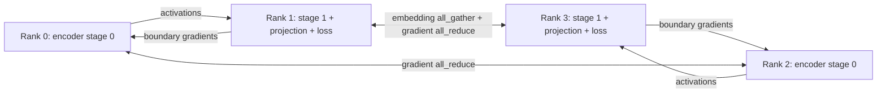

# Sharded SimCLR with PyTorch Distributed

[](https://github.com/shlomi1993/sharded-simclr-project/actions/workflows/ci.yml)
[](https://www.python.org/)
[](https://pytorch.org/)

A distributed training and profiling project that splits ResNet18 across paired processes, synchronizes replicated stages, and tunes batch size and shard boundaries using per-rank traces. The training protocol is implemented directly with `torch.distributed` point-to-point transfers and collectives.

**What it demonstrates:** model sharding, manual gradient propagation across process boundaries, stage-wise data parallelism, distributed contrastive loss, and performance diagnosis backed by saved artifacts.

The runnable workload uses CPU processes and the Gloo backend with deterministic synthetic images. It is a systems experiment: learned representation quality and GPU scaling are not evaluated.

## Architecture



Each even/odd pair forms one model replica. Even ranks prepare two augmented views per image and execute the first encoder stage. Odd ranks execute the second stage and projection head, gather embeddings across replicas, compute the contrastive objective, and return activation gradients. Each stage group averages gradients before its local SGD update.

The default split is after `layer2`; `layer1` and `layer3` are also supported. The minimum launch is four processes, forming two replicas. Global batch size counts source images: `local_batch_size × (world_size / 2)`. Each source image produces two views.

See [architecture and training protocol](docs/architecture.md) and [design decisions](docs/design.md).

## Quick start

From the repository root, create a Python 3.12 environment and install the project:

```bash
python3.12 -m venv .venv
source .venv/bin/activate
python -m pip install --upgrade pip
python -m pip install -e '.[dev]'
```

Alternatively, run `conda env create -f environment.yml` and `conda activate sharded-simclr` from this directory. On Linux, a CPU-only installation can be selected before the editable install:

```bash
python -m pip install torch==2.9.1 torchvision==0.24.1 \
    --index-url https://download.pytorch.org/whl/cpu
python -m pip install -e '.[dev]'
```

No dataset download, credentials, tracking server, or GPU is needed. Four ResNet18 processes can use several GB of memory; start with a small local batch.

```bash
export OMP_NUM_THREADS=1
python -m torch.distributed.run --rdzv-backend=c10d --rdzv-endpoint=127.0.0.1:0 --local-addr=127.0.0.1 --nproc_per_node=4 \
    train.py --local-batch-size 4 --dataset-size 128 \
    --num-steps 5 --profile --run-name baseline
python analyze.py --run-dir output/baseline
```

Expect `run_config.json`, `metrics.csv`, and four `traces/rank*.json` files in `output/baseline/`. Profiling excludes the first two warmup steps, so use at least three steps. Open a trace file in [Perfetto](https://ui.perfetto.dev/) to inspect the rank timeline.

## Profile, tune, compare

Run a small automated sweep over two batch sizes and two split points:

```bash
python controller.py --batch-sizes 4 8 --split-layers layer1 layer2 \
    --num-steps 5 --dataset-size 128 --nproc 4
```

The controller ranks successful runs by global source images/s, then breaks exact ties using communication/waiting and a stage balance heuristic. It saves every successful configuration and the selected result to `output/controller_log.json`.

For a manual batch-size sweep, run `bash scripts/sweep.sh`. For a baseline → analysis → follow-up → comparison walkthrough, run:

```bash
bash demo.sh --no-wait --baseline-bs 8 --followup-bs 4 --num-steps 5
```

The follow-up is a candidate configuration; it is not guaranteed to be faster. See [operations](docs/operations.md) for runtime options and [benchmark methodology](docs/benchmarks.md) for interpreting measurements.

## Example results

The repository includes a [historical CPU sweep](examples/legacy_cpu_sweep/README.md) with original configuration and per-step metrics:

| Local batch | Global source batch | Recorded source images/s |
|---:|---:|---:|
| 4 | 8 | 5.76 |
| 8 | 16 | 5.65 |
| 16 | 32 | 5.46 |
| 32 | 64 | 5.21 |

This run set favors the smallest tested batch. Hardware metadata, repeat measurements, and raw profiler traces were not retained with these examples, so the table illustrates the analysis workflow rather than establishing a portable speedup or current benchmark. New run artifacts are ignored by Git.

## Repository layout

```text
train.py                    # Distributed training lifecycle
analyze.py                  # Per-rank trace analysis
controller.py               # Batch-size and split-layer sweep
summarize_sweep.py           # Manual sweep summary and diagnosis
src/                        # Model, loss, augmentation, groups, training step, metrics
scripts/sweep.sh             # Manual sweep runner
demo.sh                     # Baseline and follow-up walkthrough
docs/                       # Architecture, design, operations, benchmarks
examples/legacy_cpu_sweep/   # Small, preserved example artifacts
tests/                      # Training, analysis, controller integration tests
.github/workflows/ci.yml     # CPU integration checks
pyproject.toml              # Dependencies and test configuration
environment.yml             # Optional Conda setup
```

## Validation

```bash
OMP_NUM_THREADS=1 python -m pytest -q
```

See the [local validation record](docs/validation.md) for verified checks and the macOS runtime adjustment used during validation.

The tests launch four-process synchronous and experimental deferred-backward runs, analyze traces, and exercise a controller sweep. They check finite losses, rank-local loss ownership, saved configuration, communication spans, stage timings, and controller selection. CI runs the suite on Linux CPU; GPU behavior is not covered.

## Scope and tradeoffs

- Remote embeddings are detached during `all_gather`; only local embeddings remain in the autograd graph. This approximates distributed SimCLR gradients.
- BatchNorm buffers remain local to each replica; parameter gradient synchronization is not synchronized BatchNorm.
- `--overlap` selects an experimental deferred backward schedule. Its name does not establish asynchronous communication or a measured pipeline speedup.
- The trainer creates both stage modules in each process, although each rank executes and optimizes only its assigned stage. This is not a demonstrated per-process memory reduction.
- Trace communication spans include blocking wait time. Their percentages are not network bandwidth measurements, and the stage balance ratio omits stage-1 backward.
- Runs produce diagnostics and metrics, with no checkpoint/resume, real-image evaluation, GPU device placement, or recovery from failed ranks.

[CV and LinkedIn project copy](docs/portfolio.md) · [Related repository review](docs/repository-review.md)
